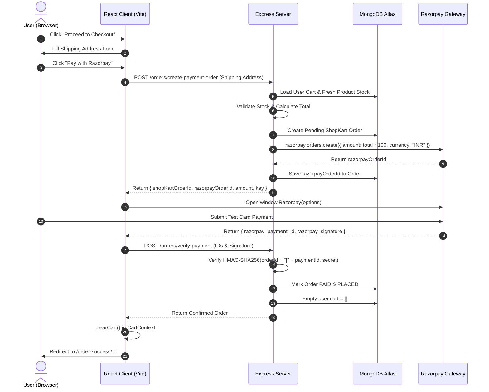

# 🛒 ShopKart — Full-Stack E-Commerce Platform

[](https://nodejs.org/)
[](https://react.dev/)
[](https://vitejs.dev/)
[](https://tailwindcss.com/)
[](https://www.mongodb.com/)
[](https://expressjs.com/)
[](https://razorpay.com/)

**ShopKart** is a production-ready, full-stack MERN e-commerce application featuring authentication, product catalog management, wishlist, persistent multi-item cart, server-side stock validation, order history snapshots, and end-to-end Razorpay Test Mode payment integration with cryptographic HMAC signature verification.

---

## 📑 Table of Contents

- [Overview](#-overview)
- [Key Features](#-key-features)
- [Architecture & Order Flow](#-architecture--order-flow)
- [Tech Stack](#-tech-stack)
- [Project Structure](#-project-structure)
- [Database Schema & Data Models](#-database-schema--data-models)
- [API Reference](#-api-reference)
- [Environment Variables](#-environment-variables)
- [Getting Started](#-getting-started)
- [Deployment to Vercel](#-deployment-to-vercel)
- [Razorpay Test Mode Guide](#-razorpay-test-mode-guide)
- [Security & Business Rules](#-security--business-rules)

---

## 🌟 Overview

ShopKart simulates a real-world commerce workflow from product discovery to payment settlement:

```text
Browse & Search Products
       ↓
Save to Wishlist / Add to Cart
       ↓
Cart Quantity Management & Stock Validation
       ↓
Shipping Address Checkout Form
       ↓
Server-Side Stock & Price Re-verification
       ↓
Razorpay Test Payment Modal
       ↓
HMAC-SHA256 Signature Verification
       ↓
Order Snapshot Saved & Cart Emptied
       ↓
Order Confirmation & Order History
```

---

## ✨ Key Features

### 🔐 Authentication & Customer Accounts
- **JWT Authentication** stored in HTTP-only cookies (`token`).
- Password hashing with **bcryptjs** and robust validation.
- Centralized `authContext` in React providing customer session state across the app.
- Protected routes on client and server ensuring user-specific resource isolation.

### 📦 Product Catalog & Discovery
- Products stored with `name`, `description`, `price`, `category`, `image`, and `stock`.
- **Debounced search** by product title and category filtering (`Electronics`, `Fashion`, `Books`, `Home`).
- Detailed single-product view with stock status and direct cart/wishlist actions.
- Cloudinary + Multer integration for dynamic product image uploads.

### ❤️ Wishlist System
- Fast toggle to save products for later without affecting cart inventory.
- Persistent in MongoDB customer record.
- Empty states, loading spinners, and instant removal actions.

### 🛍️ Shopping Cart & Global State
- Persistent MongoDB user cart with product reference and quantity.
- Stock boundaries: Users cannot increase quantity beyond currently available stock.
- Instant item increment, decrement, and deletion.
- **Derived State**: Subtotal (`Σ price × quantity`) and total item count are computed in real time at context level—never stored stale in database.
- Dynamic Navbar cart badge that updates immediately across components without refreshing.

### 💳 Checkout & Order Processing
- 6-field client-validated shipping form (Full Name, 10-digit Phone, Address, City, State, 6-digit Pincode).
- **Server-Side Pricing**: Client-submitted totals are ignored; prices are recalculated directly from MongoDB.
- **Pre-Payment Stock Verification**: Verifies stock availability immediately before order creation to prevent race conditions.
- **Historical Snapshot**: Saves product name, price, image, and quantity into the Order document so future product updates do not alter historical invoices.

### ⚡ Secure Razorpay Payment Integration
- Server creates an official Razorpay Order in paise (`amount × 100`).
- Frontend triggers the official Razorpay Checkout modal dynamically.
- Server verifies the payment using **Node.js `crypto` HMAC-SHA256** on `razorpay_order_id + "|" + razorpay_payment_id` against `RAZORPAY_KEY_SECRET`.
- Cart is cleared **only** after the signature is verified and order marked `PAID`.

### 📜 Orders Management & Details
- Customer-specific order history sorted newest-first.
- Dedicated `/orders/:id` page displaying item snapshots, shipping destination, order status (`PLACED`, `CONFIRMED`, `SHIPPED`, `DELIVERED`), and payment status.
- Strict ownership verification (`403 Forbidden` if a user attempts to view another customer's order).

---

## 🔄 Architecture & Order Flow



---

## 🛠️ Tech Stack

### Frontend
- **React 19** with Hooks (`useState`, `useEffect`, `useContext`, `useCallback`)
- **Vite 8** for fast development and production bundling
- **Tailwind CSS v4** for clean, responsive UI styling
- **React Router 7** for declarative client-side routing & route guards
- **Axios** with `withCredentials: true` for HTTP-only cookie transmission

### Backend
- **Node.js** (ES Modules)
- **Express 5** for RESTful API architecture
- **MongoDB & Mongoose 9** for document data modeling
- **JSON Web Token (JWT)** & **cookie-parser** for authentication
- **Razorpay Node SDK** & native `crypto` for HMAC-SHA256 signature verification
- **Multer** & **Cloudinary** for image upload management
- **dotenv** for configuration management

---

## 📁 Project Structure

```text
SHOPKART/
├── CLIENT/
│   └── vite-project/
│       ├── public/               # Static assets & icons
│       ├── src/
│       │   ├── assets/           # Images & logos
│       │   ├── components/       # Reusable UI components
│       │   │   ├── CartItem.jsx      # Cart row with +/- controls & subtotal
│       │   │   ├── Navbar.jsx        # Sticky navigation with live cart badge
│       │   │   ├── OrderCard.jsx     # Order summary item for history
│       │   │   ├── ProductCard.jsx   # Catalog item with add to cart/wishlist
│       │   │   ├── SearchBar.jsx     # Search & category filter bar
│       │   │   └── WishlistCard.jsx  # Wishlist item card
│       │   ├── context/          # React Context providers
│       │   │   ├── authContext.jsx   # User login & session state
│       │   │   └── CartContext.jsx   # Global cart state & mutation actions
│       │   ├── pages/            # View pages
│       │   │   ├── Cart.jsx          # Cart page & order summary
│       │   │   ├── Checkout.jsx      # Shipping form & Razorpay trigger
│       │   │   ├── Home.jsx          # User home dashboard
│       │   │   ├── Login.jsx         # Sign in page
│       │   │   ├── OrderDetails.jsx  # Single order snapshot view
│       │   │   ├── Orders.jsx        # Order history page
│       │   │   ├── OrderSuccess.jsx  # Confirmation & receipt screen
│       │   │   ├── ProductDetails.jsx# Single product preview
│       │   │   ├── Products.jsx      # Product listing with filters
│       │   │   ├── Register.jsx      # Sign up page
│       │   │   └── Wishlist.jsx      # Wishlist manager
│       │   ├── routes/           # Protected and public route guards
│       │   │   ├── ProtectedRoute.jsx
│       │   │   └── PublicRoute.jsx
│       │   ├── services/
│       │   │   └── api.js            # Axios client & centralized API calls
│       │   ├── App.jsx           # App routes & provider hierarchy
│       │   ├── index.css         # Tailwind & base styles
│       │   └── main.jsx          # React DOM entry point
│       ├── package.json
│       └── vite.config.js
│
├── SERVER/
│   ├── config/
│   │   └── razorpay.js           # Razorpay SDK initialization
│   ├── controllers/
│   │   ├── cart_controllers.js   # Add, get, patch quantity, delete cart
│   │   ├── customer_controllers.js # Register, login, logout, get me
│   │   ├── order_controllers.js  # Create payment order, verify HMAC, list
│   │   ├── product_controllers.js# Product CRUD & image uploads
│   │   └── wishlist_controllers.js# Wishlist toggling & retrieval
│   ├── middleware/
│   │   ├── authMiddleware.js     # JWT cookie extraction & validation
│   │   └── upload.js             # Multer storage configuration
│   ├── models/
│   │   ├── customer_model.js     # Customer schema with cart & wishlist
│   │   ├── order_model.js        # Order schema with item snapshots
│   │   └── product_model.js      # Product schema with price & inventory
│   ├── routes/
│   │   ├── cart_routes.js        # /cart endpoints
│   │   ├── customer_routes.js    # /customers endpoints
│   │   ├── order_routes.js       # /orders endpoints
│   │   ├── product_routes.js     # /products endpoints
│   │   └── wishlist_routes.js    # /wishlist endpoints
│   ├── utils/
│   │   ├── cloudinary.js         # Cloudinary configuration
│   │   └── generateToken.js      # JWT generator & cookie setter
│   ├── .env                      # Environment secret keys
│   ├── index.js                  # Express entry point & database connection
│   └── package.json
└── README.md
```

---

## 🗄️ Database Schema & Data Models

### 1. Customer (`Customer`)
```js
{
  name: { type: String, required: true },
  email: { type: String, required: true, unique: true },
  password: { type: String, required: true },
  phone: { type: String, required: true },
  wishlist: [{ type: ObjectId, ref: "Product" }],
  cart: [
    {
      product: { type: ObjectId, ref: "Product", required: true },
      quantity: { type: Number, default: 1, min: 1 }
    }
  ]
}
```

### 2. Product (`Product`)
```js
{
  name: { type: String, required: true },
  description: { type: String, required: true },
  price: { type: Number, required: true, min: 1 },
  category: { type: String, required: true },
  image: { type: String, required: true },
  stock: { type: Number, required: true, min: 0 }
}
```

### 3. Order (`Order`)
```js
{
  user: { type: ObjectId, ref: "Customer", required: true },
  items: [
    {
      product: { type: ObjectId, ref: "Product", required: true },
      name: { type: String, required: true },
      price: { type: Number, required: true },
      quantity: { type: Number, required: true },
      image: { type: String }
    }
  ],
  shippingAddress: {
    fullName: String,
    phone: String,
    addressLine1: String,
    city: String,
    state: String,
    pincode: String
  },
  totalAmount: { type: Number, required: true },
  paymentStatus: { type: String, enum: ["PENDING", "PAID", "FAILED"], default: "PENDING" },
  status: { type: String, enum: ["PENDING_PAYMENT", "PLACED", "CONFIRMED", "SHIPPED", "DELIVERED"], default: "PENDING_PAYMENT" },
  razorpayOrderId: String,
  razorpayPaymentId: String
}
```

---

## 🔌 API Reference

### 👤 Customer Endpoints (`/customers`)
| Method | Endpoint | Auth | Description |
|---|---|:---:|---|
| `POST` | `/customers/register` | ❌ | Create new customer account |
| `POST` | `/customers/login` | ❌ | Authenticate and issue HTTP-only JWT cookie |
| `POST` | `/customers/logout` | ❌ | Clear session cookie |
| `GET` | `/customers/me` | ✅ | Get currently authenticated customer profile |

### 📦 Product Endpoints (`/products`)
| Method | Endpoint | Auth | Description |
|---|---|:---:|---|
| `GET` | `/products` | ❌ | List products with optional `?search=` and `?category=` |
| `GET` | `/products/:id` | ❌ | Get single product details |
| `POST` | `/products/create` | ✅ | Create new product with image upload |

### ❤️ Wishlist Endpoints (`/wishlist`)
| Method | Endpoint | Auth | Description |
|---|---|:---:|---|
| `POST` | `/wishlist/:productId` | ✅ | Add product to user wishlist |
| `GET` | `/wishlist` | ✅ | Retrieve user wishlist with populated products |
| `DELETE` | `/wishlist/:productId` | ✅ | Remove product from user wishlist |

### 🛒 Cart Endpoints (`/cart`)
| Method | Endpoint | Auth | Description |
|---|---|:---:|---|
| `POST` | `/cart/:productId` | ✅ | Add product to cart (increments qty if present) |
| `GET` | `/cart` | ✅ | Get populated cart with product info and stock |
| `PATCH` | `/cart/:productId` | ✅ | Update quantity (validated against current stock) |
| `DELETE` | `/cart/:productId` | ✅ | Remove single item from cart |

### 💳 Order & Payment Endpoints (`/orders`)
| Method | Endpoint | Auth | Description |
|---|---|:---:|---|
| `POST` | `/orders/create-payment-order` | ✅ | Validate stock, create ShopKart order & Razorpay order |
| `POST` | `/orders/verify-payment` | ✅ | Verify HMAC-SHA256 signature, mark PAID, clear cart |
| `GET` | `/orders` | ✅ | Get all orders of authenticated customer (newest first) |
| `GET` | `/orders/:id` | ✅ | Get single order with item snapshots (ownership checked) |

---

## 🔑 Environment Variables

Create a `.env` file in the `SERVER/` directory with the following variables:

```env
# Server Port
PORT=7000

# MongoDB Connection String
dbURL=mongodb+srv://<username>:<password>@cluster0.mongodb.net/?retryWrites=true&w=majority

# JWT Authentication Secret
JWT_SECRET=your_jwt_secret_key_here

# Cloudinary Storage Credentials
CLOUDINARY_CLOUD_NAME=your_cloudinary_cloud_name
CLOUDINARY_API_KEY=your_cloudinary_api_key
CLOUDINARY_API_SECRET=your_cloudinary_api_secret

# Razorpay Test Mode Credentials (Dashboard > Settings > API Keys)
RAZORPAY_KEY_ID=rzp_test_xxxxxxxxxxxxxxxx
RAZORPAY_KEY_SECRET=xxxxxxxxxxxxxxxxxxxxxxxx
```

> **Security Note:** `RAZORPAY_KEY_SECRET` and `JWT_SECRET` must **never** be exposed to frontend code or checked into version control.

---

## 🚀 Getting Started

### Prerequisites
- [Node.js](https://nodejs.org/) (v18 or higher recommended)
- [MongoDB](https://www.mongodb.com/) (Local instance or MongoDB Atlas cluster)
- [Razorpay Account](https://dashboard.razorpay.com/) (Test mode enabled)

### 1. Clone the Repository
```bash
git clone https://github.com/your-username/SHOPKART.git
cd SHOPKART
```

### 2. Configure Backend
```bash
cd SERVER
npm install
```
Create `SERVER/.env` using the template provided above. Then start the backend server:
```bash
node index.js
```
The server will run on `http://localhost:7000`.

### 3. Configure Frontend
Open a new terminal window:
```bash
cd CLIENT/vite-project
npm install
npm run dev
```
The client will launch on `http://localhost:5173`.

---

## 🌐 Deployment to Vercel

ShopKart is configured for **Unified Full-Stack Deployment** on Vercel. Both the React frontend and Express serverless backend deploy together under the exact same domain, ensuring seamless 1st-party cookie authentication without third-party cookie restrictions or CORS issues.

### Option A: Deploy via GitHub (Recommended)

1. **Commit and push** your latest changes to GitHub:
   ```bash
   git add .
   git commit -m "Configure project for Vercel deployment"
   git push origin main
   ```
2. Go to [Vercel Dashboard](https://vercel.com/dashboard) and click **"Add New..." > "Project"**.
3. Import your GitHub repository (`SHOP-KART-FULL-STACK-`).
4. **Project Configuration**:
   - **Framework Preset**: `Vite` or `Other`
   - **Root Directory**: Leave as `./` (Root)
   - The root `vercel.json` and `package.json` will automatically configure:
     - Frontend build: `cd CLIENT/vite-project && npm install && npm run build`
     - Output Directory: `CLIENT/vite-project/dist`
     - Backend API routes: `/api` (powered by `api/index.js` serverless function)
5. **Environment Variables**:
   In the **Environment Variables** section on Vercel, add the following:
   | Variable Name | Value |
   |---|---|
   | `NODE_ENV` | `production` |
   | `dbURL` | Your MongoDB Atlas connection string |
   | `JWT_SECRET` | Your JWT secret key |
   | `CLOUDINARY_CLOUD_NAME` | Your Cloudinary Cloud Name |
   | `CLOUDINARY_API_KEY` | Your Cloudinary API Key |
   | `CLOUDINARY_API_SECRET` | Your Cloudinary API Secret |
   | `RAZORPAY_KEY_ID` | Your Razorpay Key ID |
   | `RAZORPAY_KEY_SECRET` | Your Razorpay Key Secret |
6. Click **Deploy**. Vercel will build and deploy your entire full-stack application!

---

## 🧪 Razorpay Test Mode Guide

To complete orders during development and evaluation:

1. Add products to the cart and proceed to `/checkout`.
2. Fill in the shipping address details and click **Pay with Razorpay**.
3. When the Razorpay test modal opens, choose **Card** and use standard test credentials:
   - **Card Number:** `4111 1111 1111 1111`
   - **Expiry Date:** Any future date (e.g., `12/28`)
   - **CVV:** Any 3 digits (e.g., `123`)
   - **OTP:** `1234`
4. Razorpay returns payment identifiers to the frontend, which posts them to `/orders/verify-payment`.
5. Upon successful signature match:
   - Order transitions to `status: "PLACED"`, `paymentStatus: "PAID"`.
   - User cart in MongoDB is cleared to `[]`.
   - Client redirects to `/order-success/:id`.
   - Navbar updates to `Cart (0)`.

---

## 🛡️ Security & Business Rules

1. **Server-Side Price Authority**: Product price is never trusted from the client payload. The backend iterates over the customer's cart, queries the database for active prices, and calculates `totalAmount`.
2. **Double Stock Verification**: Product stock is verified both when adding to the cart and immediately before generating the Razorpay payment order.
3. **Strict HMAC Signature Verification**:
   ```javascript
   const body = order.razorpayOrderId + "|" + razorpay_payment_id;
   const expectedSignature = crypto
     .createHmac("sha256", process.env.RAZORPAY_KEY_SECRET)
     .update(body)
     .digest("hex");
   ```
4. **Conditional Cart Clearing**: The customer's cart is **never** cleared when the checkout page opens or when payment is cancelled/failed. It is cleared only after cryptographic verification succeeds.
5. **Ownership Isolation**: Every access to `/orders/:id` checks `order.user.toString() === req.customer._id.toString()`, rejecting unauthorized requests with `403 Forbidden`.

---

## 📜 License

This project is licensed under the [ISC License](LICENSE). Built for educational and commercial demonstration purposes.
